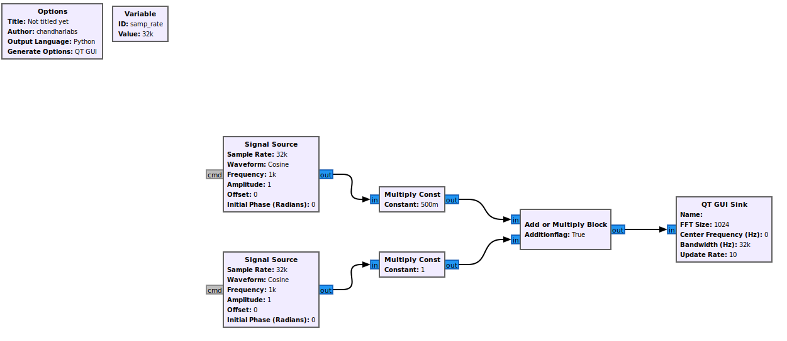

# Experiment 1: Using the Embedded Python Block in GNU Radio Companion

## Aim

To create a custom signal processing block in Python using the Embedded Python Block in GNU Radio Companion, and to use it to add or multiply two signals.

**Software:** GNU Radio Companion. The finished flowgraph is provided as `embeddedPythonBlock.grc`.

## Procedure

### Step 1: Build the flowgraph

1.  Open GNU Radio Companion and create a new flowgraph.

2.  Set the **samp_rate** variable to 32000 (32k).

3.  Add two **Signal Source** blocks and set each to: Output Type **Complex**, Waveform **Cosine**, Frequency 1000 (1k), Amplitude 1, Offset 0, Initial Phase 0, Sample Rate samp_rate.

4.  Add two **Multiply Const** blocks (type **Complex**). Set the constant to 0.5 for the first source and 1 for the second.

5.  Add a **QT GUI Sink** (type **Complex**) with FFT Size 1024, Center Frequency 0 and Bandwidth samp_rate.

### Step 2: Add the Embedded Python Block

1.  Press **Ctrl+F**, type Python Block and double-click **Python Block** (the Embedded Python Block) to add it to the flowgraph.

2.  Double-click the block to open its properties and click **Open in Editor**. If asked, choose a text editor.

3.  Replace the example code with the code shown in the listing below.

4.  Save the file in the editor. GNU Radio Companion reads the code and updates the block. The block is now named **Add or Multiply Block**, with two inputs, one output and an **Additionflag** parameter.

```python
import numpy as np
from gnuradio import gr


class blk(gr.sync_block):

    def __init__(self, additionFlag=True):
        gr.sync_block.__init__(
            self,
            name='Add or Multiply Block',
            in_sig=[np.complex64, np.complex64],
            out_sig=[np.complex64]
        )
        self.additionFlag = additionFlag

    def work(self, input_items, output_items):
        if self.additionFlag:
            output_items[0][:] = input_items[0][:] + input_items[1][:]
        else:
            output_items[0][:] = input_items[0][:] * input_items[1][:]
        return len(output_items[0])
```

### Step 3: Connect the blocks

1.  Connect the first Signal Source to the first Multiply Const, and the second Signal Source to the second Multiply Const.

2.  Connect the first Multiply Const to input **0** and the second Multiply Const to input **1** of the Add or Multiply Block.

3.  Connect the output of the Add or Multiply Block to the QT GUI Sink.

<figure markdown>

<figcaption>Figure 1.1: Flowgraph using the Embedded Python Block</figcaption>
</figure>

### Step 4: Run and observe

1.  Click **Run** (or press **F6**). The QT GUI Sink window opens.

2.  With **Additionflag** set to True, the two signals are added. Observe the spectrum, time and constellation plots.

3.  Stop the flowgraph, double-click the Add or Multiply Block and set **Additionflag** to False.

4.  Run the flowgraph again. The two signals are now multiplied. Compare the plots with the previous run.

!!! success "Expected result"
    With addition, the output is a single 1 kHz tone with amplitude 1.5 (0.5 + 1). With multiplication, the two 1 kHz complex tones multiply to give a single 2 kHz tone with amplitude 0.5 (0.5 × 1), because the frequencies add. Check these against what you see in the plots.

## Understanding the code

- **Imports:** numpy is used for the data types and array operations, and gr provides the GNU Radio block classes.

- **Class blk:** the Embedded Python Block uses the first class it finds. gr.sync_block is used because the block produces one output sample for each input sample. Other base classes are basic_block, decim_block and interp_block.

- **__init__:** the arguments of this function appear as parameters in GRC. All of them must have default values, so additionFlag=True appears as **Additionflag**.

- **name:** the text shown on the block in the flowgraph.

- **in_sig and out_sig:** the number and data type of the input and output ports. Here there are two complex inputs and one complex output.

- **self.additionFlag:** an attribute with the same name as a parameter is updated whenever the parameter changes in GRC.

- **work:** called repeatedly with the input and output buffers. It adds or multiplies the two inputs sample by sample, stores the result in output_items\[0\] and returns the number of samples produced.

## Description

The Embedded Python Block lets you write your own processing block directly inside a flowgraph, without building a separate out-of-tree module. Its parameters, ports and name come from the Python code, so changing the code and saving it changes the block in GRC.

In this experiment one block performs two different operations, selected by a parameter. This shows how a custom block can be controlled from the GRC properties window.
