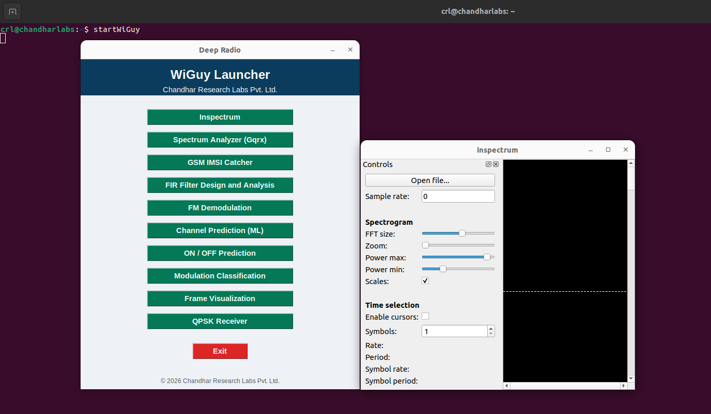

# Experiment 2: Time-Frequency Analysis using Inspectrum

## Aim

To study and analyse recorded RF signals using the Inspectrum signal visualisation tool.

## Procedure

1.  Open the terminal and run the command `startWiGuy`.

2.  The **WiGuy Launcher** window appears.

3.  Click the **Inspectrum** button.

4.  The Inspectrum window opens.

<figure markdown>

<figcaption>Figure 2.1: WiGuy Launcher with the Inspectrum window open</figcaption>
</figure>

### Using Inspectrum

1.  In the Inspectrum window, click **File → Open**.

2.  Select the recorded IQ sample file to analyse.

3.  The signal spectrogram and waveform are displayed.

4.  Use the mouse scroll wheel to zoom in and out.

5.  Click and drag to move through different portions of the signal.

6.  Observe the frequency variations, signal bursts and modulation patterns in the spectrogram.

## Description

Inspectrum is a graphical signal analysis tool for inspecting IQ sample recordings obtained from Software Defined Radio (SDR) systems. It displays signals in both the time and frequency domains, helping users observe signal characteristics, modulation behaviour and spectral activity.
