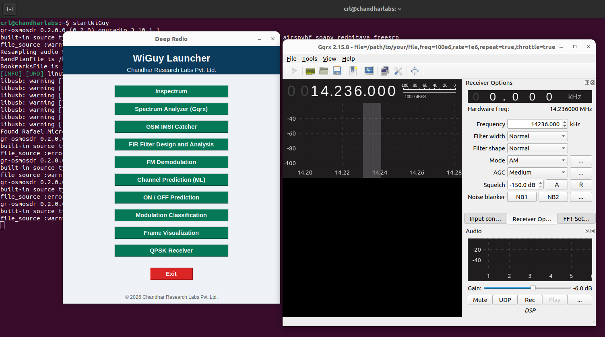

# Experiment 3: Spectrum Analysis using GQRX

## Aim

To perform real-time spectrum monitoring and signal analysis using the GQRX SDR receiver available in the WiGuy platform.

## Procedure

1.  Open the terminal and run the command `startWiGuy`.

2.  The **WiGuy Launcher** window appears.

3.  Click the **Spectrum Analyzer (GQRX)** button.

4.  The GQRX application window opens.

<figure markdown>

<figcaption>Figure 3.1: GQRX spectrum and waterfall display</figcaption>
</figure>

### Using GQRX

1.  If required, configure the SDR input device.

2.  Click **Start DSP** to begin signal reception.

3.  Enter the desired frequency in the frequency control section.

4.  Observe the spectrum and waterfall displays for RF activity.

5.  Adjust the following parameters as needed:

    - Gain

    - Filter bandwidth

    - Mode (AM / FM / SSB)

    - Frequency tuning

6.  Analyse nearby wireless signals using the real-time spectrum display.

## Description

GQRX is an SDR-based radio receiver and spectrum analyser for monitoring RF signals in real time. It provides frequency spectrum visualisation, waterfall displays and demodulation of various wireless communication signals.
