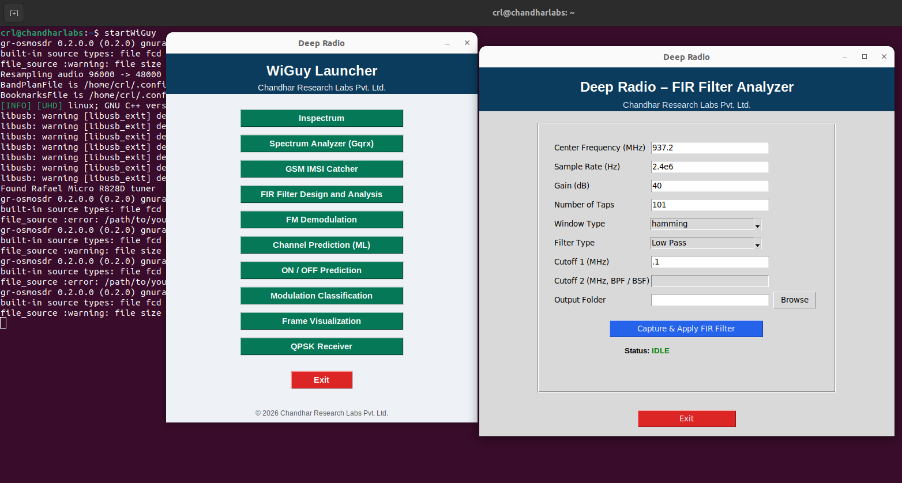

# Experiment 4: FIR Filter Design and Analysis

## Aim

To design and analyse Finite Impulse Response (FIR) filters for RF signal processing using the FIR Filter Analyzer in the WiGuy platform.

**Hardware:** RTL-SDR

## Procedure

1.  Open the terminal and run the command `startWiGuy`.

2.  The **WiGuy Launcher** window appears.

3.  Click the **FIR Filter Design and Analysis** button.

4.  The FIR Filter Analyzer window opens.

<figure markdown>

<figcaption>Figure 4.1: FIR Filter Analyzer window</figcaption>
</figure>

### Using the FIR Filter Analyzer

1.  Enter the **Center Frequency** in MHz.

2.  Enter the **Sample Rate** of the SDR device.

3.  Select the **Filter Type**:

    - Low Pass

    - High Pass

    - Band Pass

    - Band Stop

4.  Enter the cutoff frequencies:

    - Cutoff 1 for low-pass and high-pass filters

    - Cutoff 1 and Cutoff 2 for band-pass and band-stop filters

5.  Enter the **Number of Taps**.

6.  Select the **Window Type**:

    - Hamming

    - Hann

    - Blackman

    - Blackman-Harris

    - Nuttall

    - Rectangular

7.  Select the output folder where the plots will be saved.

8.  Click **Capture & Apply FIR Filter**.

9.  The application captures RF samples with the RTL-SDR and applies the selected filter.

10. The generated plots are displayed automatically.

## Description

This experiment performs FIR filter design and real-time RF signal filtering on samples captured from the RTL-SDR. The selected filter is applied to the IQ samples and plots of the filter response and the signal spectrum are generated.

Several filter types and window functions are supported, so their effect on signal processing behaviour can be compared.
