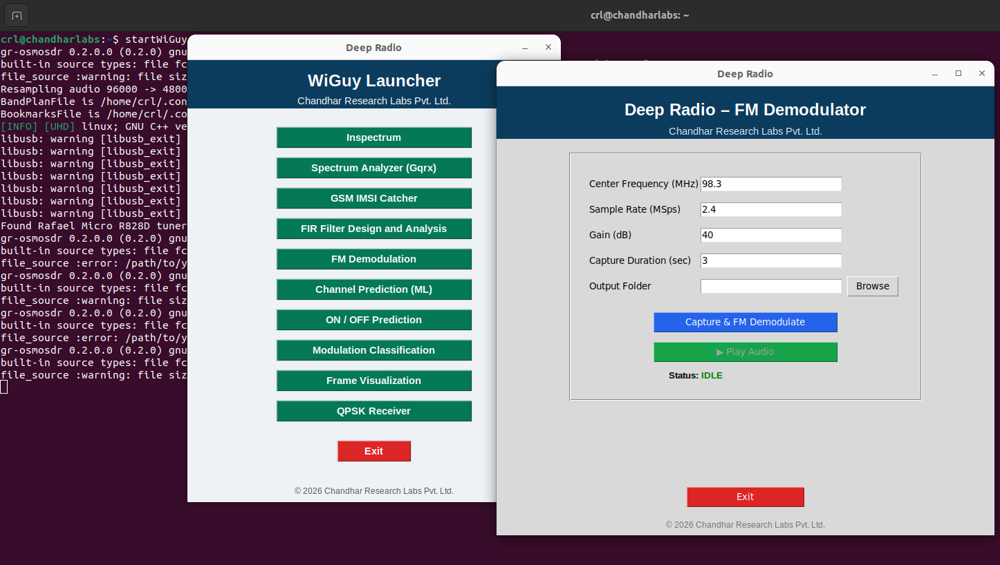

# Experiment 5: FM Demodulation

## Aim

To receive and demodulate an FM signal using the RTL-SDR and analyse the recovered audio with the FM Demodulator tool in the WiGuy platform.

**Hardware:** RTL-SDR

## Procedure

1.  Open the terminal and run the command `startWiGuy`.

2.  The **WiGuy Launcher** window appears.

3.  Click the **FM Demodulation** button.

4.  The FM Demodulator window opens.

<figure markdown>

<figcaption>Figure 5.1: FM Demodulator window</figcaption>
</figure>

### Using the FM Demodulator

1.  Enter the **Center Frequency** of the FM station in MHz.

2.  Enter the **Sample Rate** in MSps.

3.  Set the **Gain**.

4.  Enter the **Capture Duration** in seconds.

5.  Select the output folder for the generated files.

6.  Click **Capture & FM Demodulate**.

7.  The system captures the FM signal with the RTL-SDR and demodulates it.

8.  When processing completes:

    - The demodulated audio file is generated.

    - Audio spectrum plots are created.

9.  Click **Play Audio** to listen to the recovered audio.

## Description

This experiment demonstrates FM reception and demodulation using SDR techniques. The RTL-SDR captures IQ samples at the selected FM broadcast frequency. The signal is filtered, decimated and FM demodulated to recover the original audio.

The recovered audio is saved as a WAV file and its spectrum is plotted for analysis.
