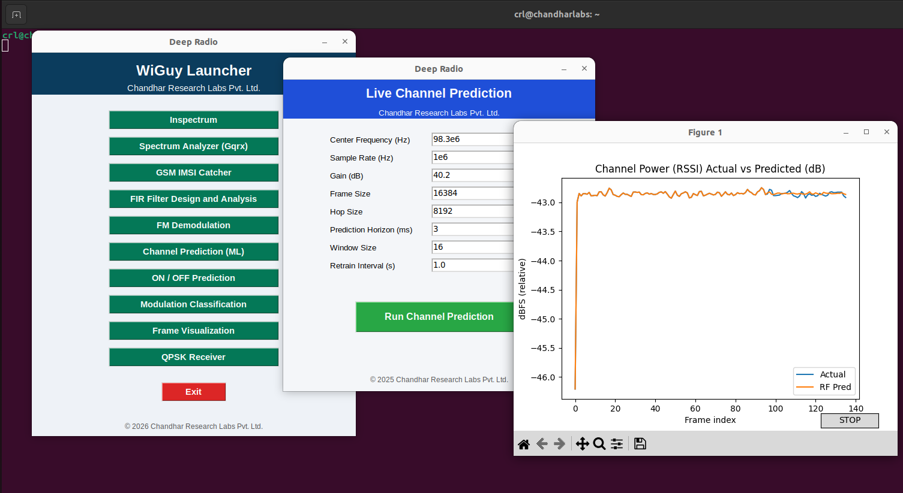

# Experiment 6: Live Channel Prediction using Machine Learning

## Aim

To predict the wireless channel in real time using machine learning on live RTL-SDR signal captures.

**Hardware:** RTL-SDR

## Procedure

1.  Open the terminal and run the command `startWiGuy`.

2.  The **WiGuy Launcher** window appears.

3.  Click the **Channel Prediction (ML)** button.

4.  The Live Channel Prediction window opens.

<figure markdown>

<figcaption>Figure 6.1: Live Channel Prediction window</figcaption>
</figure>

### Using the Channel Prediction Tool

1.  Enter the SDR parameters:

    - Center Frequency

    - Sample Rate

    - Gain

2.  Configure the prediction parameters:

    - Frame Size

    - Hop Size

    - Prediction Horizon

    - Window Size

    - Retrain Interval

3.  Click **Run Channel Prediction**.

4.  The system starts capturing live RF samples from the RTL-SDR.

5.  The machine learning model processes the incoming data and predicts future channel conditions in real time.

6.  Prediction results and channel activity are shown continuously in the terminal window.

## Description

This experiment demonstrates real-time wireless channel prediction using machine learning and SDR. The RTL-SDR captures live RF data, which is processed frame by frame.

Configurable frame processing, sliding windows and retraining intervals let the system continuously estimate and predict channel behaviour, enabling adaptive analysis of the RF environment.
