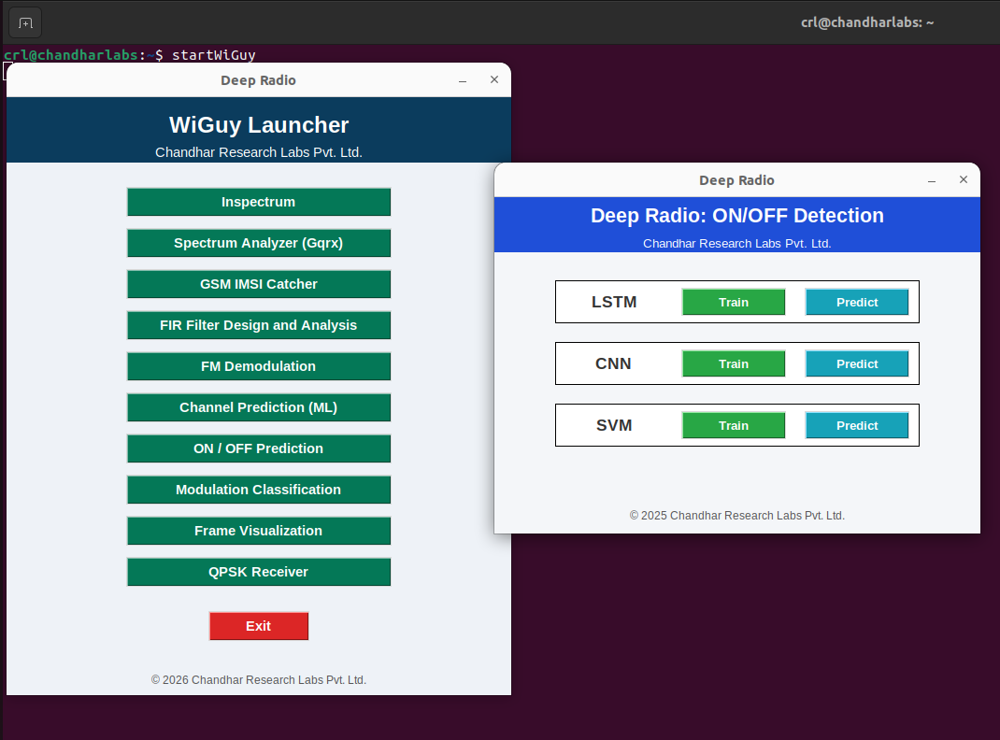

# Experiment 7: ON/OFF Activity Prediction using Machine Learning

## Aim

To detect and predict ON/OFF channel activity using machine learning models (LSTM, CNN and SVM) in the WiGuy platform.

## Procedure

1.  Open the terminal and run the command `startWiGuy`.

2.  The **WiGuy Launcher** window appears.

3.  Click the **ON / OFF Prediction** button.

4.  The Deep Radio: ON/OFF Detection window opens.

<figure markdown>

<figcaption>Figure 7.1: WiGuy Launcher and the ON/OFF Detection window</figcaption>
</figure>

### Using the ON/OFF Detection Tool

1.  Choose a model: **LSTM**, **CNN** or **SVM**.

2.  Click **Train** next to the chosen model to train it.

3.  After training, click **Predict** to run the trained model.

4.  Observe the predicted ON/OFF activity.

5.  Repeat with the other models to compare their results.

## Description

This experiment applies machine learning to detect whether a channel is ON (occupied) or OFF (idle). Three model types are available: a Long Short-Term Memory (LSTM) network, a Convolutional Neural Network (CNN) and a Support Vector Machine (SVM). Each can be trained and then used for prediction from the same window.
