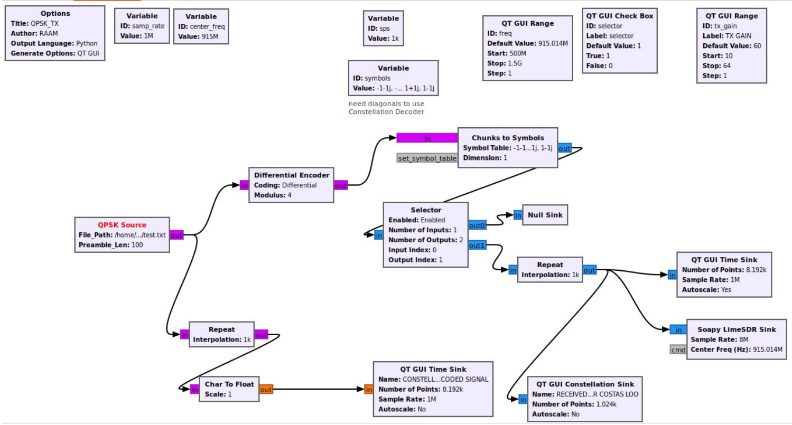
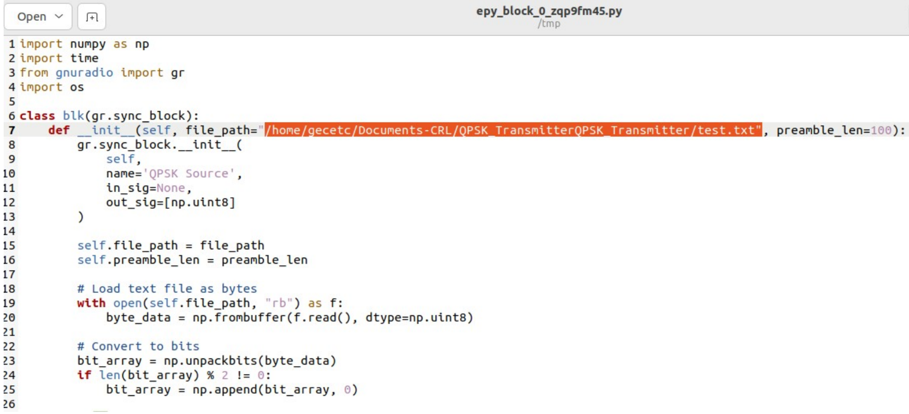
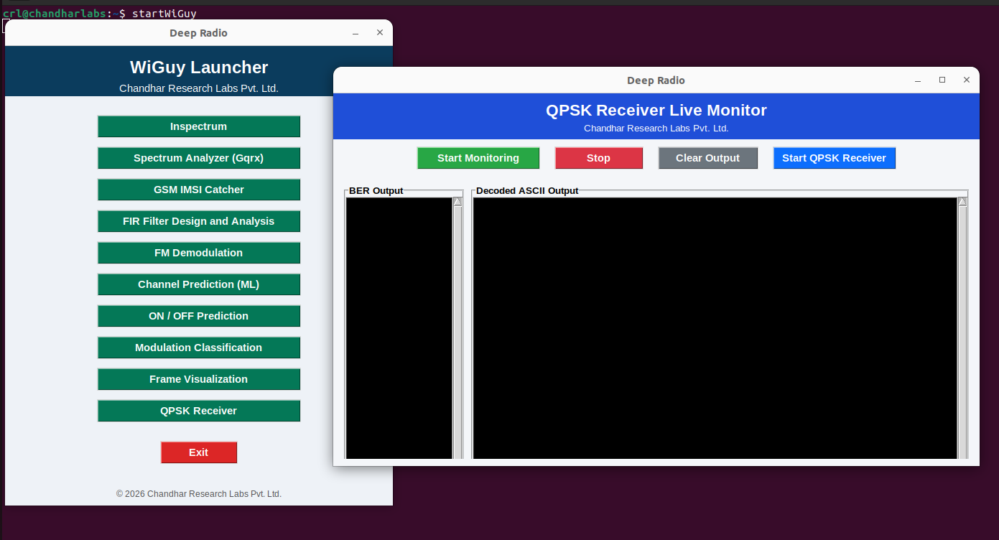
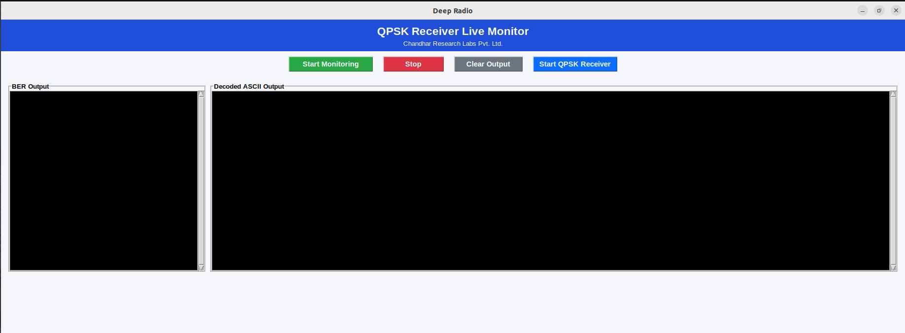
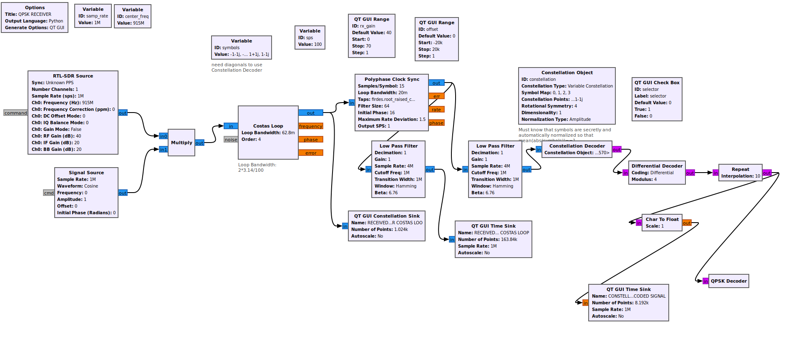

# Experiment 8: QPSK Transmission, Reception and BER Analysis

## Aim

To transmit and receive QPSK-modulated signals, observe the decoded data and analyse the Bit Error Rate (BER) using the QPSK Receiver tool in the WiGuy platform.

## Part A: QPSK Transmission

1.  Open **Files** and go to the folder `Documents-CRL/QPSK_Transmitter`.

2.  Open `QPSK_TX.grc` with GNU Radio Companion.

    <figure markdown>
    
    <figcaption>Figure 8.1: QPSK transmitter flowgraph in GNU Radio Companion</figcaption>
    </figure>

3.  Click the **QPSK Source** block, open its properties and choose the source file.

    <figure markdown>
    
    <figcaption>Figure 8.2: Selecting the source file in the QPSK Source block</figcaption>
    </figure>

4.  Select the transmitting SDR by enabling its sink block and disabling the other two:

    - **HackRF:** enable **osmocom Sink**; disable **PlutoSDR Sink** and **Soapy LimeSDR Sink**.

    - **PlutoSDR:** enable **PlutoSDR Sink**; disable **osmocom Sink** and **Soapy LimeSDR Sink**.

    - **LimeSDR:** enable **Soapy LimeSDR Sink**; disable **osmocom Sink** and **PlutoSDR Sink**.

    !!! note
        Only one sink block should be enabled at a time.

5.  Run the flowgraph.

### Understanding the QPSK transmitter flowgraph

The flowgraph turns a text file into a stream of QPSK symbols and transmits it. The main signal path is:

**QPSK Source → Differential Encoder → Chunks to Symbols → Selector → Repeat → SDR Sink**

**Variables and controls**

| **Item**                    | **Purpose**                                                                                                                     |
|-----------------------------|---------------------------------------------------------------------------------------------------------------------------------|
| samp_rate                   | Sample rate of the flowgraph: 1 MHz.                                                                                            |
| center_freq                 | Centre frequency: 915 MHz.                                                                                                      |
| sps                         | Samples per symbol: 1000. It is used as the interpolation factor of the Repeat blocks.                                          |
| symbols                     | The QPSK constellation table: -1-1j, -1+1j, 1+1j, 1-1j. The points are on the diagonals, as the Constellation Decoder requires. |
| freq (QT GUI Range)         | Transmit frequency slider, 500 MHz to 1.5 GHz, default 915.014 MHz.                                                             |
| selector (QT GUI Check Box) | Check box with values 1 and 0, used with the Selector block as a transmit on/off switch.                                        |
| tx_gain (QT GUI Range)      | Transmit gain slider, 10 to 64, default 60.                                                                                     |

**Blocks in the signal path**

| **Block**                                     | **What it does**                                                                                                                                                                                                                                                                                                     |
|-----------------------------------------------|----------------------------------------------------------------------------------------------------------------------------------------------------------------------------------------------------------------------------------------------------------------------------------------------------------------------|
| QPSK Source                                   | An Embedded Python Block (see Experiment 1). It reads the file given in File_Path (here `test.txt`) as bytes and unpacks them into bits. If the number of bits is odd, a 0 is added so the bits can be grouped in pairs. Each pair of bits is one QPSK symbol. Preamble_Len is the length of the preamble, set to 100. |
| Differential Encoder                          | Modulus 4, Coding: Differential. It encodes each symbol as the change from the previous symbol. The receiver then does not need to know the absolute phase of the carrier.                                                                                                                                           |
| Chunks to Symbols                             | Maps each symbol value (0 to 3) to a complex constellation point using the symbols table.                                                                                                                                                                                                                            |
| Selector                                      | One input and two outputs. Output Index 1 sends the signal on to the transmit path. Output Index 0 sends it to the Null Sink, which discards it, so transmission stops.                                                                                                                                              |
| Repeat                                        | Interpolation 1k. Repeats each symbol 1000 times, so each symbol lasts 1000 samples.                                                                                                                                                                                                                                 |
| SDR Sink (Soapy LimeSDR, PlutoSDR or osmocom) | Sends the signal to the SDR hardware at the centre frequency. Only the sink for the SDR you use is enabled (see the steps above).                                                                                                                                                                                    |

**Blocks used for display**

| **Block**                                 | **What it shows**                                                                                                         |
|-------------------------------------------|---------------------------------------------------------------------------------------------------------------------------|
| Repeat → Char To Float → QT GUI Time Sink | A second branch from the QPSK Source. It shows the source data as a waveform, for comparison with the transmitted signal. |
| QT GUI Time Sink (after the Repeat block) | Shows the transmitted signal in the time domain.                                                                          |
| QT GUI Constellation Sink                 | Shows the constellation of the transmitted signal, which should show four points.                                         |

## Part B: QPSK Reception

1.  Open the terminal and run the command `startWiGuy`.

2.  The **WiGuy Launcher** window appears.

3.  Click the **QPSK Receiver** button.

4.  The QPSK Receiver Monitor window opens.

<figure markdown>

<figcaption>Figure 8.3: QPSK Receiver Monitor window</figcaption>
</figure>

**Alternative:** open the folder `Documents-WiGuy/QPSK_Receiver`, open a terminal there and run `python3 qpskGui.py`.

<figure markdown>

<figcaption>Figure 8.4: QPSK Receiver Monitor window opened with qpskGui.py</figcaption>
</figure>

### Using the QPSK Receiver Tool

1.  Click **Start Monitoring** to begin live monitoring of the BER values and decoded ASCII output.

2.  Click **Start QPSK Receiver**. The receiver flowgraph starts receiving QPSK signals.

3.  Observe the outputs:

    - **BER Output** panel: live Bit Error Rate values.

    - **Decoded ASCII Output** panel: the recovered transmitted data.

4.  Click **Clear Output** to clear earlier BER and decoded-data logs.

5.  Click **Stop** to end monitoring.

### Understanding the QPSK receiver flowgraph

The receiver flowgraph captures the signal from an RTL-SDR, recovers the carrier phase and symbol timing, and then decodes the QPSK symbols back into data. The main signal path is:

**RTL-SDR Source → Multiply → Costas Loop → Polyphase Clock Sync → Low Pass Filter → Constellation Decoder → Differential Decoder → QPSK Decoder**

<figure markdown>

<figcaption>Figure 8.5: QPSK receiver flowgraph in GNU Radio Companion</figcaption>
</figure>

**Variables and controls**

| **Item**                    | **Purpose**                                                                                                                                                                                                                    |
|-----------------------------|--------------------------------------------------------------------------------------------------------------------------------------------------------------------------------------------------------------------------------|
| samp_rate                   | Sample rate of the flowgraph: 1 MHz.                                                                                                                                                                                           |
| center_freq                 | Centre frequency: 915 MHz, the same as the transmitter.                                                                                                                                                                        |
| sps                         | Samples per symbol variable: 100.                                                                                                                                                                                              |
| symbols                     | The QPSK constellation table (-1-1j, -1+1j, 1+1j, 1-1j). The points are on the diagonals, as the Constellation Decoder requires.                                                                                               |
| rx_gain (QT GUI Range)      | Receive gain slider, 0 to 70, default 40.                                                                                                                                                                                      |
| offset (QT GUI Range)       | Frequency offset slider, -20 kHz to 20 kHz, default 0. It is used to correct the frequency difference between the transmitter and receiver oscillators.                                                                        |
| selector (QT GUI Check Box) | Check box with values 1 and 0, default 0.                                                                                                                                                                                      |
| Constellation Object        | Defines the constellation used by the decoder: Variable Constellation type, symbol map 0, 1, 2, 3, rotational symmetry 4, amplitude normalisation. The symbols are normalised automatically so that their mean magnitude is 1. |

**Blocks in the signal path**

| **Block**                  | **What it does**                                                                                                                                                                                                                                                                                            |
|----------------------------|-------------------------------------------------------------------------------------------------------------------------------------------------------------------------------------------------------------------------------------------------------------------------------------------------------------|
| RTL-SDR Source             | Receives the signal from the RTL-SDR at 915 MHz with a sample rate of 1 MHz. Gains: RF 40 dB, IF 20 dB, baseband 20 dB.                                                                                                                                                                                     |
| Signal Source and Multiply | The Signal Source generates a cosine (frequency 0, amplitude 1). The Multiply block multiplies it with the received samples. A non-zero frequency here shifts the received signal, which is how a frequency offset can be corrected.                                                                        |
| Costas Loop                | Order 4, loop bandwidth 62.8 m (2π/100). It locks onto the carrier of the QPSK signal and removes the remaining frequency and phase error.                                                                                                                                                                  |
| Polyphase Clock Sync       | Samples/Symbol 15, loop bandwidth 20 m, root raised cosine taps, filter size 64, output 1 sample per symbol. It finds the best sampling instant for each symbol (symbol timing recovery) and outputs one sample per symbol. The samples-per-symbol value must match the symbol rate of the received signal. |
| Low Pass Filter            | Cutoff 1 MHz, transition width 1 MHz, Hamming window, sample rate 4 MHz. It removes noise outside the signal band before decoding.                                                                                                                                                                          |
| Constellation Decoder      | Uses the Constellation Object to decide which of the four constellation points each received symbol is closest to, and outputs the symbol value (0 to 3).                                                                                                                                                   |
| Differential Decoder       | Modulus 4, Coding: Differential. It reverses the differential encoding applied at the transmitter, so the result does not depend on the carrier phase that the receiver locked to.                                                                                                                          |
| QPSK Decoder               | Receives the decoded symbols and recovers the transmitted data. The QPSK Receiver Monitor shows this as decoded ASCII text and the BER.                                                                                                                                                                     |

**Blocks used for display**

| **Block**                                 | **What it shows**                                                                                                                                                                                                            |
|-------------------------------------------|------------------------------------------------------------------------------------------------------------------------------------------------------------------------------------------------------------------------------|
| QT GUI Constellation Sink                 | Shows the constellation after the Costas Loop. When the loop is locked, four clear points should appear.                                                                                                                     |
| QT GUI Time Sink (received signal)        | Shows the received signal after filtering, in the time domain.                                                                                                                                                               |
| Repeat → Char To Float → QT GUI Time Sink | The Repeat block repeats each decoded symbol 10 times, and Char To Float converts it for display. The time sink shows the decoded symbols as a waveform, which can be compared with the source data seen at the transmitter. |

## Description

This experiment demonstrates real-time QPSK transmission, reception and monitoring using SDR. The receiver demodulates the QPSK symbols, calculates the BER and reconstructs the transmitted ASCII data.

The monitoring interface continuously shows BER measurements and the decoded payload, so signal quality and communication performance can be studied in real time.
