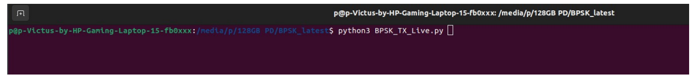
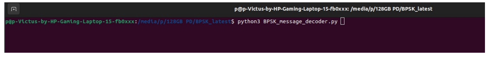
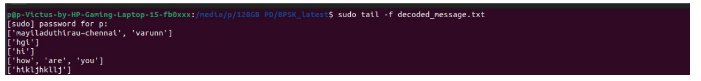

# Experiment 9: BPSK Transmission and Reception (Live Text)

## Aim

To transmit text messages live over a BPSK link and decode them at the receiver.

## Part A: BPSK Live Text Transmission

1.  Open **Files** and go to the BPSK_Latest folder.

2.  Open a terminal in this folder.

3.  Run `python3 BPSK_TX_Live.py`.

    <figure markdown>
    
    <figcaption>Figure 9.1: Starting the BPSK transmitter</figcaption>
    </figure>

4.  A text box appears for entering data.

5.  Type the message to send and press **Enter**.

## Part B: BPSK Live Text Reception

1.  Open **Files** and go to the BPSK_Latest folder.

2.  Open a terminal in this folder.

3.  Run `python3 BPSK_message_decoder.py`.

    <figure markdown>
    
    <figcaption>Figure 9.2: Starting the BPSK message decoder</figcaption>
    </figure>

4.  Open a new terminal in the same window.

5.  Run sudo tail -f `decoded_message.txt` to display decoded messages as they arrive.

<figure markdown>

<figcaption>Figure 9.3: Following the decoded message file</figcaption>
</figure>

## Description

This experiment demonstrates live text communication using Binary Phase Shift Keying (BPSK). Typed text is modulated and transmitted by the SDR; the receiver demodulates it and writes the decoded text to `decoded_message.txt`, which is followed live in a second terminal.
