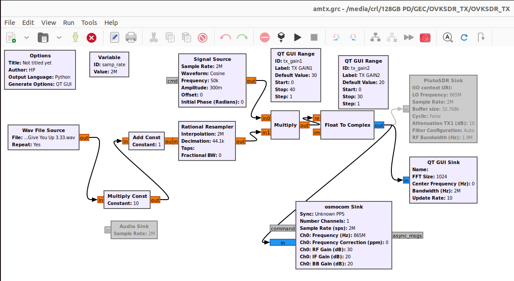
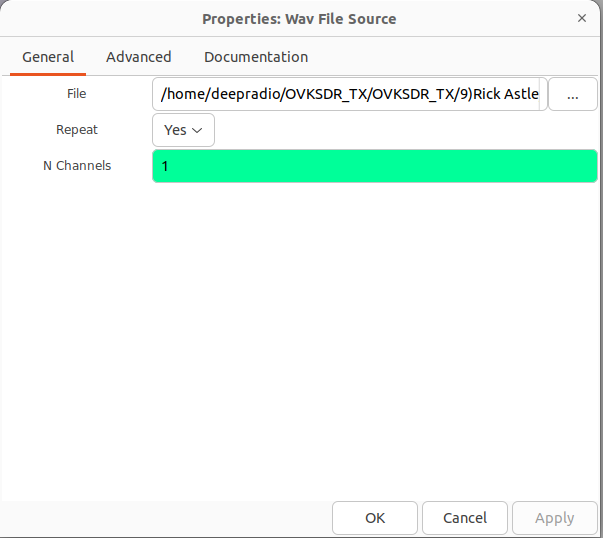
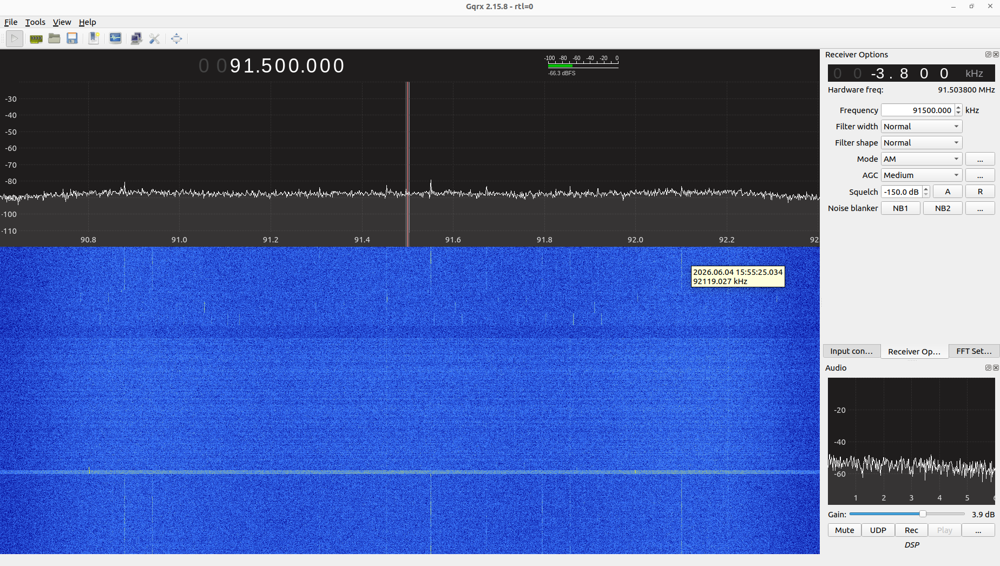

# Experiment 10: AM Transmission and Reception

## Aim

To transmit an audio file using Amplitude Modulation (AM) and receive it with GQRX.

## Part A: AM Transmission

1.  Open **Files** and go to the OVKSDR_TX folder.

2.  Open `amtx.grc` with GNU Radio Companion.

    <figure markdown>
    
    <figcaption>Figure 10.1: AM transmitter flowgraph</figcaption>
    </figure>

3.  Double-click the **Wav File Source** block, select the audio file to transmit and set **Repeat** as required.

<figure markdown>

<figcaption>Figure 10.2: Wav File Source properties</figcaption>
</figure>

## Part B: AM Reception

1.  Open **GQRX**.

2.  In **Receiver Options**, tune to the transmitting frequency.

3.  Set **Mode** to **AM** and adjust the gain.

<figure markdown>

<figcaption>Figure 10.3: GQRX tuned to the AM signal</figcaption>
</figure>

## Description

This experiment demonstrates AM transmission and reception. A WAV file is amplitude modulated in GNU Radio and transmitted by the SDR, and the signal is received and demodulated in GQRX.
