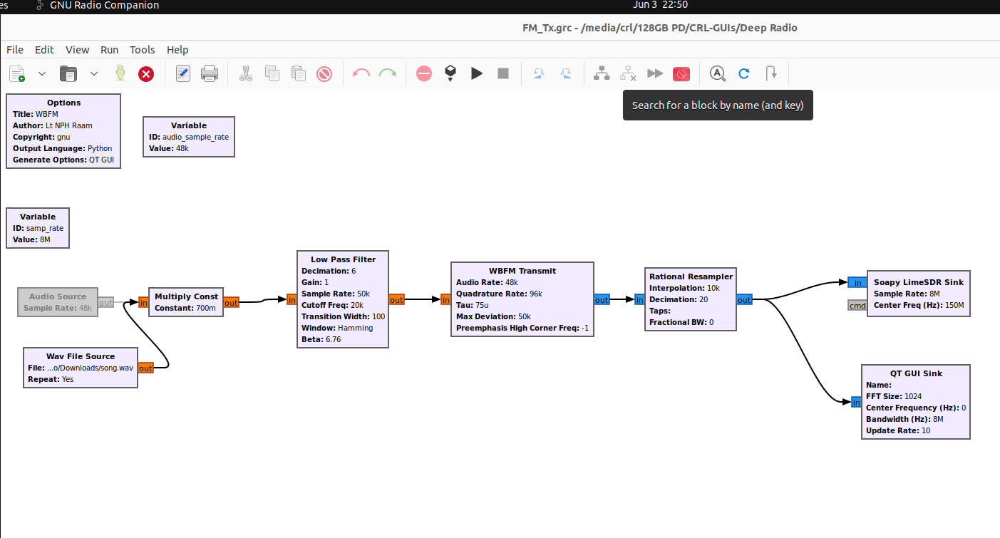
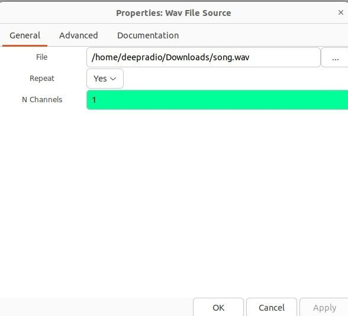
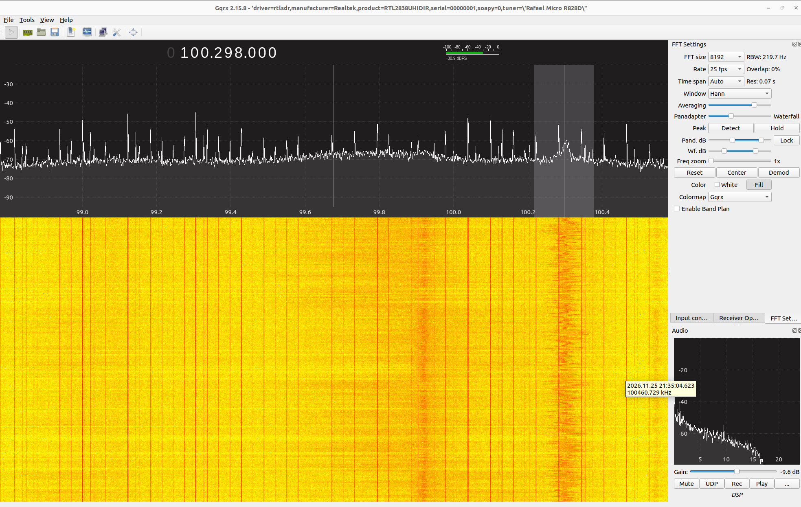

# Experiment 11: FM Transmission and Reception

## Aim

To transmit an audio file using Frequency Modulation (FM) and receive it with GQRX.

## Part A: FM Transmission

1.  Open **Files** and go to the `Documents-CRL` folder.

2.  Open `FM_Tx.grc` with GNU Radio Companion.

    <figure markdown>
    
    <figcaption>Figure 11.1: FM transmitter flowgraph</figcaption>
    </figure>

3.  Double-click the **Wav File Source** block, select the audio file to transmit and set **Repeat** as required.

<figure markdown>

<figcaption>Figure 11.2: Wav File Source properties</figcaption>
</figure>

## Part B: FM Reception

1.  Open **GQRX**.

2.  In **Receiver Options**, tune to the transmitting frequency.

3.  Set **Mode** to **FM** and adjust the gain.

<figure markdown>

<figcaption>Figure 11.3: GQRX tuned to the FM signal</figcaption>
</figure>

## Description

This experiment demonstrates FM transmission and reception. A WAV file is frequency modulated in GNU Radio and transmitted by the SDR, and the signal is received and demodulated in GQRX.
