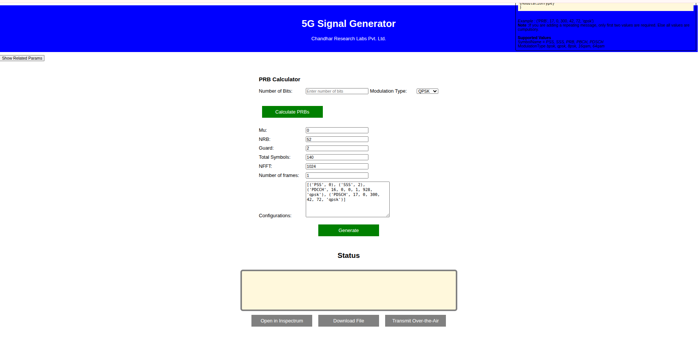

# Experiment 12: 5G Signal Generation and Transmission

## Aim

To generate 5G NR IQ signals, analyse them with Inspectrum and transmit them over the air using SDR hardware.

## Procedure

1.  Open the terminal and run start5GSignalGenerator.

2.  A link appears in the terminal. Click it to open the **5G Signal Generator** web interface.

<figure markdown>

<figcaption>Figure 12.1: 5G Signal Generator web interface</figcaption>
</figure>

### Using the 5G Signal Generator

1.  Configure the signal parameters:

    - Numerology (µ)

    - Number of Resource Blocks (NRB)

    - Guard Band

    - FFT Size

    - Total Signal Length

    - Number of Frames

    - Modulation Sequence

2.  Select the modulation type:

    - QPSK

    - 16QAM

    - 64QAM

3.  Enter the number of bits to transmit.

4.  Click **Calculate PRBs** to estimate the required Physical Resource Blocks.

5.  Click **Generate 5G Signal**. The 5G NR IQ file is generated.

6.  Then you can:

    - Open the generated IQ file in Inspectrum.

    - Download the IQ file.

    - Transmit the signal over the air using the SDR hardware.

## Description

This experiment generates 5G NR IQ samples from configurable parameters such as numerology, modulation type, FFT size and resource allocation. The generated signal can be visualised in Inspectrum and transmitted over the air using SDR devices such as the USRP. The tool also calculates the PRBs required for a given modulation order and number of transmitted bits.
