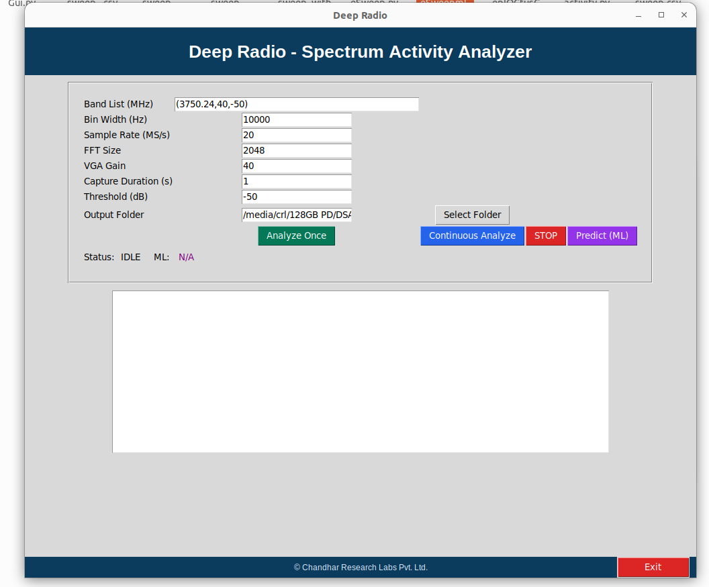

# Experiment 13: Over-the-Air 5G Traffic Prediction using Machine Learning

## Aim

To monitor RF spectrum activity with a HackRF SDR, build a spectrum-activity dataset and classify wireless activities with a machine learning model.

**Hardware:** HackRF

## Procedure

### Step 1: Launch the Spectrum Activity Analyzer

1.  Open the terminal and run StartSpectrumAnalyzer.

2.  The Spectrum Analyzer Launcher window appears.

<figure markdown>

<figcaption>Figure 13.1: Spectrum Analyzer Launcher</figcaption>
</figure>

### Step 2: Configure the monitoring parameters

1.  Enter the parameters:

    - Band List (MHz)

    - Bin Width (Hz)

    - Sample Rate (MS/s)

    - FFT Size

    - VGA Gain

    - Capture Duration

    - Threshold (dB)

2.  Select the threshold mode:

    - Common Threshold

    - Individual Threshold

3.  Select the output folder for the generated data.

### Step 3: Collect spectrum activity data

1.  Click **Analyze Once** for a single scan, or **Continuous Analyze** to monitor for the specified duration.

2.  The output window shows:

    - Frequency band

    - Activity percentage

    - Threshold value

    - Activity status (ACTIVE / IDLE)

3.  The measurements are saved automatically to `activity_sweep.csv`.

### Step 4: Generate the activity dataset

1.  While monitoring, perform each of these activities in turn:

    - Google Meet

    - YouTube streaming

    - Web browsing

    - IP Webcam streaming

    - iPerf uplink traffic

    - iPerf downlink traffic

2.  Make sure the data for every activity is recorded in the CSV file.

### Step 5: Train the machine learning model

1.  Run the RF Activity Classification program.

2.  It loads the spectrum activity dataset.

3.  Activity labels are assigned from the recorded activity periods.

4.  Statistical features are extracted using sliding windows.

5.  The data is split into training and testing sets.

6.  A Random Forest classifier is trained on the extracted features.

### Step 6: Evaluate the model

1.  Check the classification accuracy shown after training.

2.  Verify that the model distinguishes the different wireless activities.

### Step 7: Save the trained model

1.  After successful training the following files are saved:

    - `rf_activity_model.pkl` (trained model)

    - `label_encoder.pkl` (label encoder)

### Step 8: Predict the activity

1.  Click **Analyze Once** or **Continuous Analyze** and let the system collect enough activity samples.

2.  Wait until enough records are stored in the dataset.

3.  Click **Predict (ML)**.

4.  The trained model analyses the most recent spectrum activity data.

5.  Read the predicted activity in the output window. It is the most likely one of the six activities listed in Step 4.

6.  Compare the prediction with the activity you are actually performing.

## Description

This experiment combines SDR-based spectrum monitoring with machine learning classification. The Spectrum Activity Analyzer monitors the selected bands with a HackRF and records spectrum occupancy to a CSV file, which forms the dataset.

The classifier extracts statistical features (mean, standard deviation, trend, maximum, minimum and activity ratio) and trains a Random Forest model to identify wireless usage scenarios from the observed spectrum behaviour.
