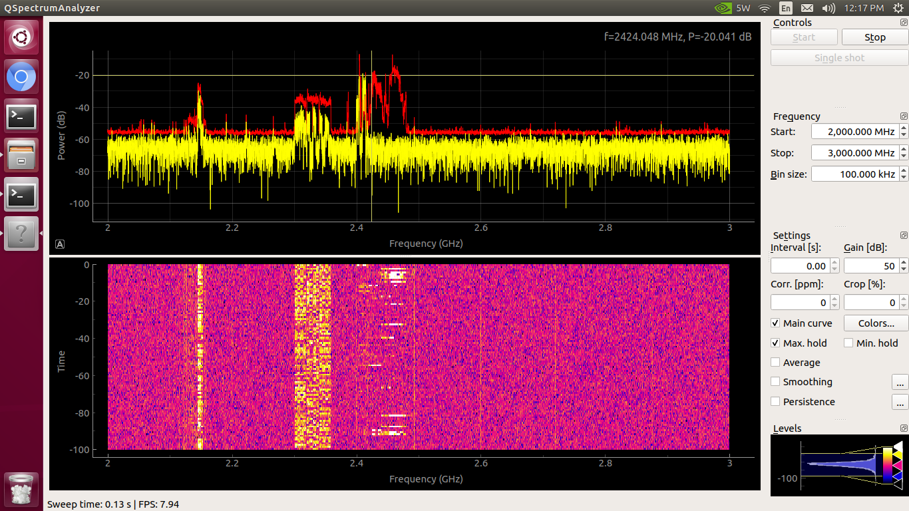

# Experiment 14: Live Spectrum Monitoring using QSpectrumAnalyzer

## Aim

To monitor the spectrum and analyse signals in real time using QSpectrumAnalyzer.

## Procedure

1.  Type qspectrumanalyzer in the Linux terminal.

2.  The QSpectrumAnalyzer window opens.

    <figure markdown>
    
    <figcaption>Figure 14.1: QSpectrumAnalyzer window</figcaption>
    </figure>

3.  Enter the start and stop frequencies on the right-hand side and click **Start**.

4.  The power spectrum and spectrogram plots are displayed.

## Description

QSpectrumAnalyzer is a graphical front end that works with an SDR to scan wide swaths of spectrum for signal activity. Its features include:

- Max peak hold

- Min peak hold

- Averaging

- Spectrum persistence
