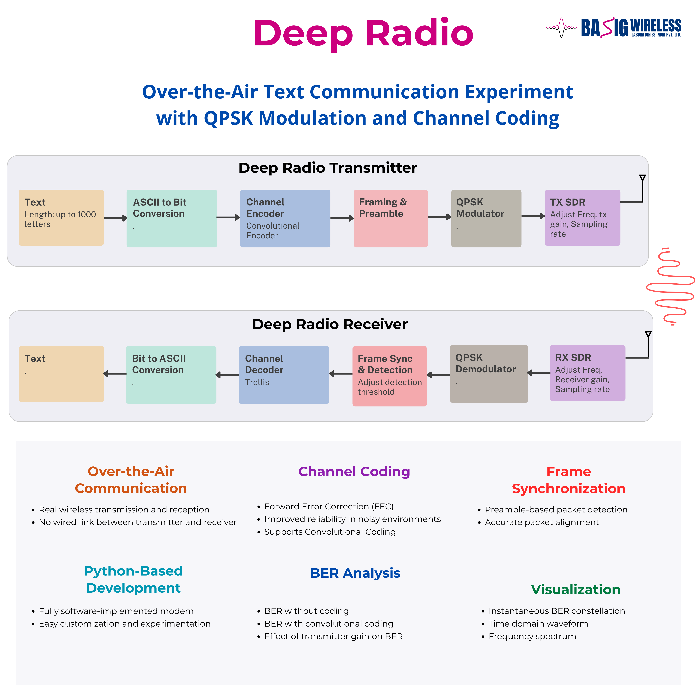

# Over-the-Air QPSK Text Link

Over-the-air text communication using **QPSK modulation and channel coding** between the Deep Radio transmitter and receiver.

## Block Diagram

!!! wip "Lab steps"
    Step-by-step instructions, parameters and expected results for this experiment are being added.
