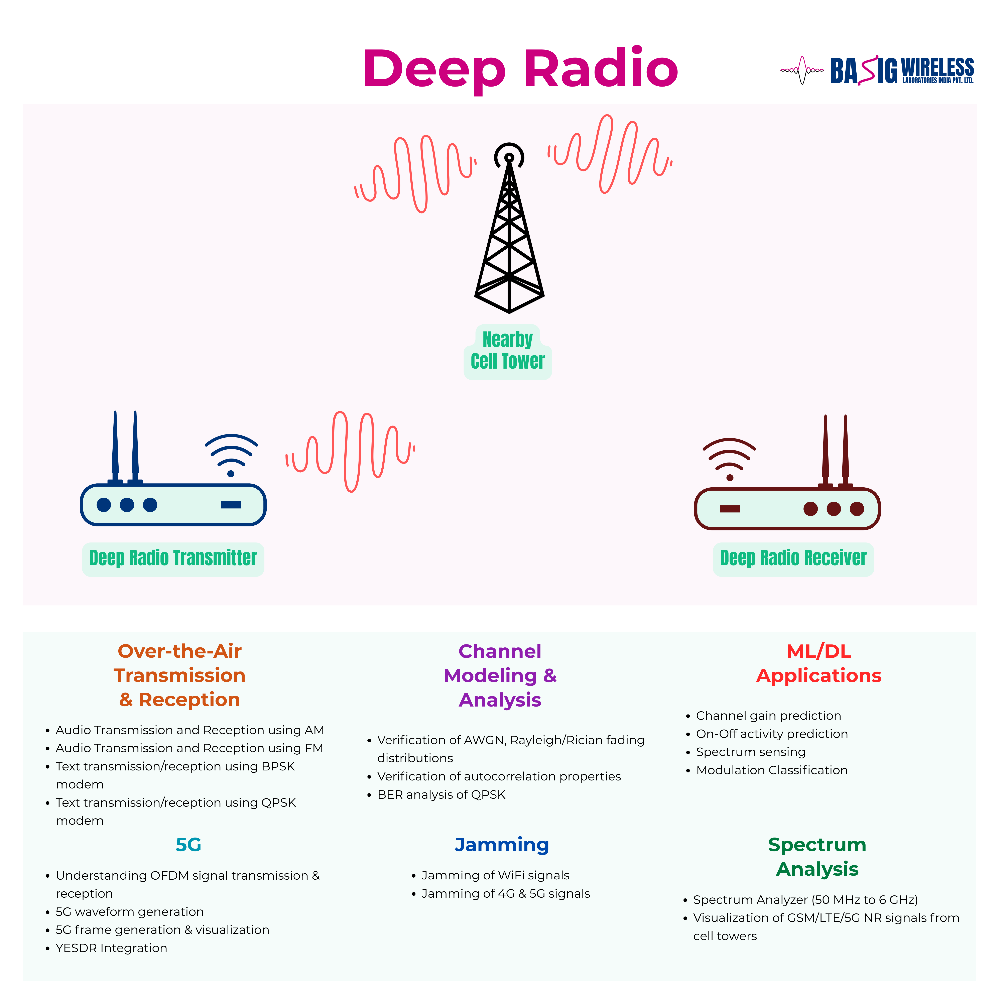

# Introduction to Deep Radio

Deep Radio is a software-defined radio (SDR) platform from BaSig Wireless Laboratories. In an SDR, many functions that are normally built into radio hardware, such as modulation, filtering and demodulation, are carried out in software on a computer. This makes it possible to study and build many different wireless systems with the same equipment.

Deep Radio is designed to:

- teach and learn the fundamentals of signal processing and wireless communications

- process real-time signals

- develop deep learning applications in the wireless domain

The platform has two units. The **Deep Radio Transmitter** can both transmit and receive, over 50 MHz to 6 GHz. The **Deep Radio Receiver** can only receive, over 50 MHz to 1.7 GHz. Both units have a monitor, keyboard and mouse, and they are programmed with Python, C and GNU Radio.

<figure markdown>

<figcaption>Overview of the Deep Radio platform and its application areas</figcaption>
</figure>

## Application areas

- **Over-the-air transmission and reception:** audio transmission and reception using AM and FM; text transmission and reception using BPSK and QPSK modems; 5G waveform generation and OFDM signal transmission and reception

- **Channel modeling and analysis:** verification of AWGN and Rayleigh/Rician fading distributions; verification of autocorrelation properties; BER analysis of QPSK

- **Jamming:** jamming of WiFi signals and of 4G and 5G signals

- **ML/DL applications:** channel gain prediction; on-off activity prediction; spectrum sensing; modulation classification

- **Spectrum analysis:** spectrum analyser from 50 MHz to 6 GHz; visualisation of GSM, LTE and 5G NR signals from cell towers

## Technical specifications

| **Specification**               | **Deep Radio Transmitter**              | **Deep Radio Receiver**                 |
|---------------------------------|-----------------------------------------|-----------------------------------------|
| Components                      | Radio unit, monitor, keyboard and mouse | Radio unit, monitor, keyboard and mouse |
| Memory                          | 128 GB SSD, 8 GB RAM                    | 128 GB SSD, 8 GB RAM                    |
| Frequency range                 | 50 MHz – 6 GHz                          | 50 MHz – 1700 MHz                       |
| Coverage range                  | 50 feet in line-of-sight conditions     | –                                       |
| Maximum sampling rate           | 20 MS/s                                 | 2.4 MS/s                                |
| Number of antennas              | 1                                       | 1                                       |
| Capability                      | Transmission and reception              | Reception                               |
| Programming languages and tools | Python, C, GNU Radio                    | Python, C, GNU Radio                    |

## Sample experiments

The platform supports the following kinds of experiment:

- 2G, 3G and 4G live spectrum and band monitoring

- Live monitoring of GSM and 4G LTE stations

- Over-the-air text transmission and reception using BPSK and QPSK modems

- Verification of AWGN and small-scale fading channel distributions, and autocorrelation properties

- Visualisation and processing of GSM and LTE signals

- OFDM transmission and analysis

- Live AM and FM transmission and reception

- Jammer for cellular and WiFi channels

- Energy detection-based spectrum sensing

- Spectrum analysis from 50 MHz to 6 GHz

- ML-based spectrum activity prediction

- ML/DL-based modulation classification (BPSK, QPSK, GMSK, 16QAM, 64QAM and others)

- 5G signal generation and transmission

- Integration with the YESDR framework (https://yesdr-standard.org)

The experiments in this manual use the WiGuy launcher together with GNU Radio Companion, GQRX, Inspectrum and other tools, as described in each experiment.
