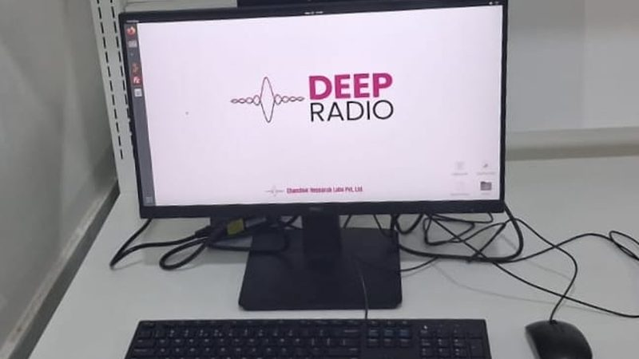

# Deep Radio Documentation

{ .bw-hero-img }

Technical documentation for Deep Radio, an SDR-based platform for teaching wireless communications, processing real-time signals and applying deep learning in the wireless domain.

<a class="bw-card" href="getting-started/">:material-rocket-launch:<strong>Getting Started</strong>What Deep Radio is, what's in the box, and the two editions.Start here :material-arrow-right:</a>

<a class="bw-card" href="hardware/specifications/">:material-chip:<strong>Hardware</strong>Specifications for Deep Radio and Deep Radio Pro, and platform capabilities.Specifications :material-arrow-right:</a>

<a class="bw-card" href="experiments/">:material-flask-outline:<strong>Experiments</strong>Lab experiments from spectrum monitoring to deep-learning modulation classification.All experiments :material-arrow-right:</a>

<a class="bw-card" href="installation/">:material-download:<strong>Installation</strong>Setting up the radio units, operating system and software.Install :material-arrow-right:</a>

<a class="bw-card" href="user-guide/">:material-book-open-variant:<strong>User Guide</strong>Running transmissions, capturing data, training and inference.User guide :material-arrow-right:</a>

<a class="bw-card" href="developer/">:material-code-braces:<strong>Developer Guide</strong>Programming Deep Radio with Python, C and GNU Radio.Developer guide :material-arrow-right:</a>

!!! info "Buying Deep Radio"
    For purchase, pricing and demos, email **sales@basigwireless.com** and mention *Deep Radio* in your message. Product overview: [basigwireless.com/products/deep-radio](https://basigwireless.com/products/deep-radio/).
